# 👋 Hi, I'm Sunil Sowrirajan

### Full Stack Developer | React.js | Node.js | TypeScript | AI & RAG

I'm a Full Stack Developer with **1 year of experience** building and shipping production-ready SaaS applications. I enjoy developing scalable web applications, designing REST APIs, optimizing backend performance, and integrating AI-powered features into real-world products.

Currently working at **Scalingwolf AI**, contributing to Thola AI — an AI-powered business intelligence platform.

## 💫 About Me

- 💻 Full Stack Developer with 1 year of professional experience.
- 🚀 Building production SaaS applications using React.js, TypeScript, Node.js and PostgreSQL.
- 🤖 Interested in LLM integration, AI Agents, RAG pipelines and AI-powered applications.
- ⚡ Experienced in REST API development, JWT authentication, Redis caching and payment gateway integration.
- 📦 Creator of an open-source npm package with **1,200+ downloads**.
- 🤝 Open to collaborating on Full Stack and AI-powered development projects.
- 📍 Based in Chennai, India.

## 💻 Tech Stack

**Frontend**

**Backend**

**Databases**

**AI & LLM**

**Tools & Deployment**

## 📊 GitHub Stats

## 🌐 Connect With Me

---

💡 *Building, learning and shipping one feature at a time.*
